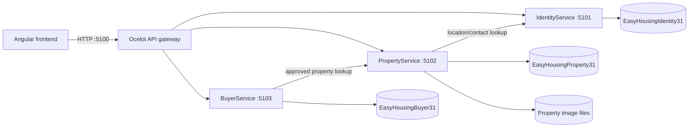

# EasyHousing Backend 3.1

Backend 3.1 is a clean-architecture rebuild of EasyHousing with three independently
deployable microservices behind a single Ocelot API gateway. The Angular frontend
uses the gateway for all API calls; the service ports are internal development
endpoints.

## What this project contains

| Component | Responsibility | Local port |
|---|---|---:|
| `IdentityService` | Accounts, password hashing, JWTs, roles, states and cities | 5101 |
| `PropertyService` | Property listings, image uploads, search and moderation | 5102 |
| `BuyerService` | Saved homes, comparison, checkout reports and transaction history | 5103 |
| `ApiGateway` | Single frontend entry point, routing and aggregated Swagger UI | 5100 |

Each microservice has four projects:

```text
<Service>/
  <Service>.Domain/          Entities and domain state
  <Service>.Application/     Use cases, DTOs and ports/interfaces
  <Service>.Infrastructure/  SQL Server, file storage and service clients
  <Service>.Api/              HTTP controllers, auth and composition root
```

Dependencies point inward: API -> Application -> Domain; Infrastructure implements
Application interfaces and depends on Domain. The gateway is a separate host and
does not own business data.

## High-level design (HLD)



The gateway is the only public API base URL used by the frontend:
`http://localhost:5100/api`. It routes identity, property and buyer paths to their
own service and their own SQL Server LocalDB database. Property media is served via
the gateway at `/media/{fileName}`. The buyer and property services use HTTP
contracts to read data owned by another service rather than sharing its database.

### Main request flows

1. **Authentication:** the frontend submits credentials to the gateway; Identity
   validates a PBKDF2 password hash and issues an 8-hour signed JWT with account ID,
   username and role claims. All three services validate the same issuer, audience
   and signing key.
2. **Property submission:** a seller submits a listing to PropertyService. The
   application verifies state/city through IdentityService, stores the listing as
   `Pending`, and returns its property ID. Photos are validated, assigned generated
   filenames and written to the property service's `uploads` directory.
3. **Moderation:** admins fetch the pending or rejected queue without knowing a
   seller ID. Approving changes the status to `Approved`; rejecting stores a reason
   and changes it to `Rejected`. Approved homes are exposed by public search. An
   approved home can separately be deactivated with a reason.
4. **Buyer actions:** BuyerService owns saved-home and checkout records. It fetches
   current approved listing details from PropertyService when rendering a cart,
   comparing homes or recording a buyer-reported direct payment.
5. **Images:** property responses include each saved image URL through the gateway.
   The frontend uses the first uploaded image in search, details, compare, saved
   homes and the moderation queue; it uses a local placeholder only when no image
   was uploaded.

## Low-level design (LLD)

### IdentityService

- **Domain:** `Account`, `State`, and `City`.
- **Application:** `IdentityApplicationService` implements login, registration,
  uniqueness checks and location/contact queries through `IAccountRepository` and
  `IPasswordService`.
- **Infrastructure:** EF Core `IdentityDbContext`, account/location repository and
  ASP.NET Core's `PasswordHasher<Account>`.
- **API:** `/api/Auth/*` and `/api/Locations/*`. A protected internal contact lookup
  is used by PropertyService; it requires `X-Internal-Api-Key`.
- Buyer/seller registration shares account fields; seller registration additionally
  requires address, state and city.

### PropertyService

- **Domain:** `PropertyListing`, `PropertyImage`, and `ListingStatus` (`Pending`,
  `Approved`, `Rejected`, `Inactive`).
- **Application:** `PropertyApplicationService` validates submissions, owns
  status transitions, resolves seller ownership, and depends on repository,
  location/contact lookup and image-storage interfaces.
- **Infrastructure:** EF Core `PropertyDbContext`/repository, IdentityService HTTP
  client and filesystem image storage.
- **API:** public approved search/details; seller create/edit/upload/list routes;
  admin pending/rejected queues, approve/reject, directory searches and deactivation.
- Search results include `images[].image`, so uploaded images are present in card
  payloads rather than falling back to arbitrary stock photos.

### BuyerService

- **Domain:** `SavedProperty` and `BuyerTransaction`.
- **Application:** `BuyerApplicationService` enforces buyer ownership, checks
  listing availability and handles compare, cart and checkout use cases.
- **Infrastructure:** EF Core `BuyerDbContext` and an HTTP property catalog client.
- **API:** compare, saved-home CRUD, FREE-code checkout recording and transaction
  history. A transaction records buyer-reported payment only; EasyHousing does not
  process or independently verify payment.

### API gateway and documentation

`ApiGateway/ocelot.json` is the route table. Swagger UI is hosted by the gateway at
[`http://localhost:5100/swagger`](http://localhost:5100/swagger) and its dropdown
contains the Identity, Property and Buyer OpenAPI documents. Service launch profiles
do not open their own documentation browser windows; only the gateway's HTTP profile
opens Swagger UI.

Important gateway routes:

| Upstream path | Destination |
|---|---|
| `/api/Auth/*`, `/api/Locations/*` | IdentityService |
| `/api/Buyer/search`, `/api/Buyer/property/*` | PropertyService |
| `/api/Buyer/compare`, `/api/Buyer/cart/*`, `/api/Buyer/checkout`, `/api/Buyer/transactions` | BuyerService |
| `/api/Seller/*`, `/api/Admin/*` | PropertyService |
| `/swagger/{identity,property,buyer}/swagger.json` | The matching service's OpenAPI document |
| `/media/{fileName}` | PropertyService uploaded image |

## Start the backend

Requirements: .NET 9 SDK/runtime and SQL Server LocalDB (`(localdb)\mssqllocaldb`).
From the EasyHousing solution directory, open four terminals and run:

```powershell
dotnet run --project backend_3.1\IdentityService\IdentityService.Api\IdentityService.Api.csproj --launch-profile http
dotnet run --project backend_3.1\PropertyService\PropertyService.Api\PropertyService.Api.csproj --launch-profile http
dotnet run --project backend_3.1\BuyerService\BuyerService.Api\BuyerService.Api.csproj --launch-profile http
dotnet run --project backend_3.1\ApiGateway\ApiGateway.csproj --launch-profile http
```

Backend 3.0 and 3.1 use the same local ports, so run only one backend version at
a time.

The gateway opens the single API documentation page. If a browser does not open,
visit `http://localhost:5100/swagger`. Then start the frontend from its directory:

```powershell
npm start
```

Open `http://localhost:4200`. The frontend's
[`api.config.ts`](../frontend/src/app/core/api.config.ts) points to the gateway.

Development accounts (created on first IdentityService startup):

```text
Admin:  admin / Admin@123
Seller: demo.seller / Demo@123
Buyer:  demo.buyer / Demo@123
```

The seeded demo listings are not required; seller accounts can create properties
through the frontend. The initial location catalogue contains Gujarat, Maharashtra,
and Karnataka with Ahmedabad, Surat, Mumbai, Pune and Bengaluru.

## Configuration and data

- Each service has a distinct LocalDB database configured in its API
  `appsettings.json`.
- For non-development deployments, replace the development defaults with environment
  variables, including `Jwt__SigningKey`, `InternalApiKey`,
  `IdentityService__InternalApiKey`, `ImageStorage__PublicBaseUrl`, and service
  connection strings. Use the same strong JWT key in all three services, restrict
  service ports to the private network, and use HTTPS.
- Property image files are stored under
  `PropertyService/PropertyService.Api/uploads` by default. Back up this directory
  alongside the property database.
- The starter uses `EnsureCreated` for a new local development database. For schema
  evolution or production, add and apply EF Core migrations rather than relying on
  `EnsureCreated`.

## Build and verification

From `backend_3.1`:

```powershell
dotnet restore backend_3.1.sln
dotnet build backend_3.1.sln --no-restore
```

Each API exposes its own development Swagger document at
`http://localhost:5101/swagger`, `:5102/swagger`, or `:5103/swagger` for direct
service diagnostics. Use the gateway document for normal frontend integration.
