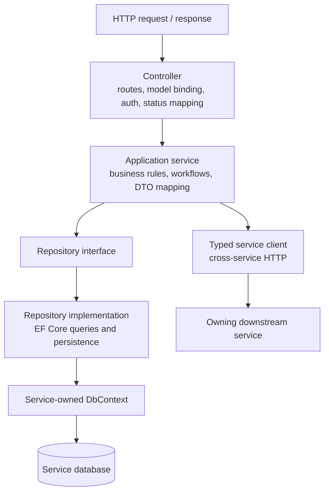
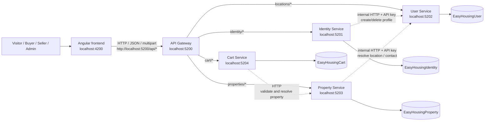
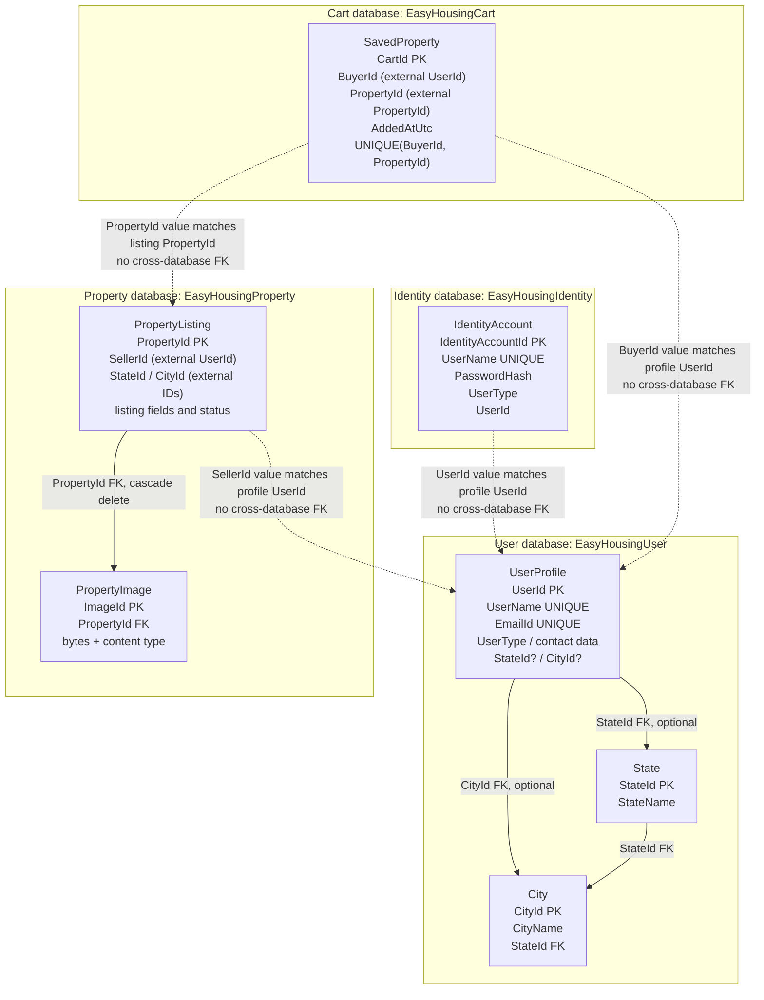
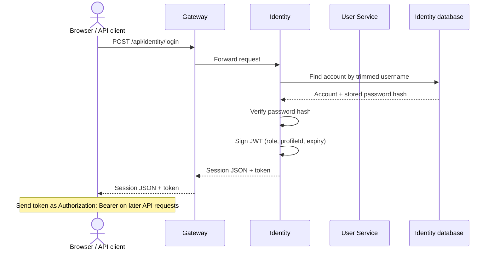
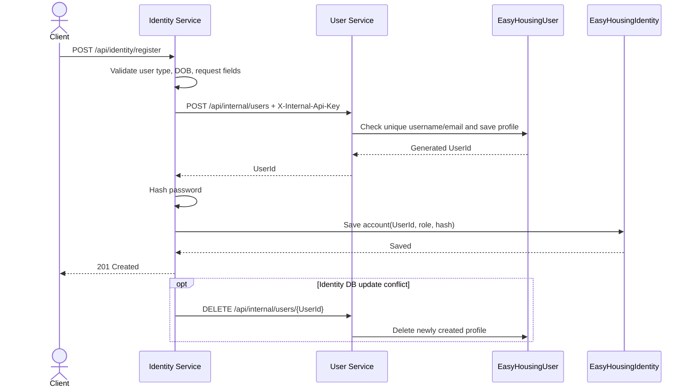
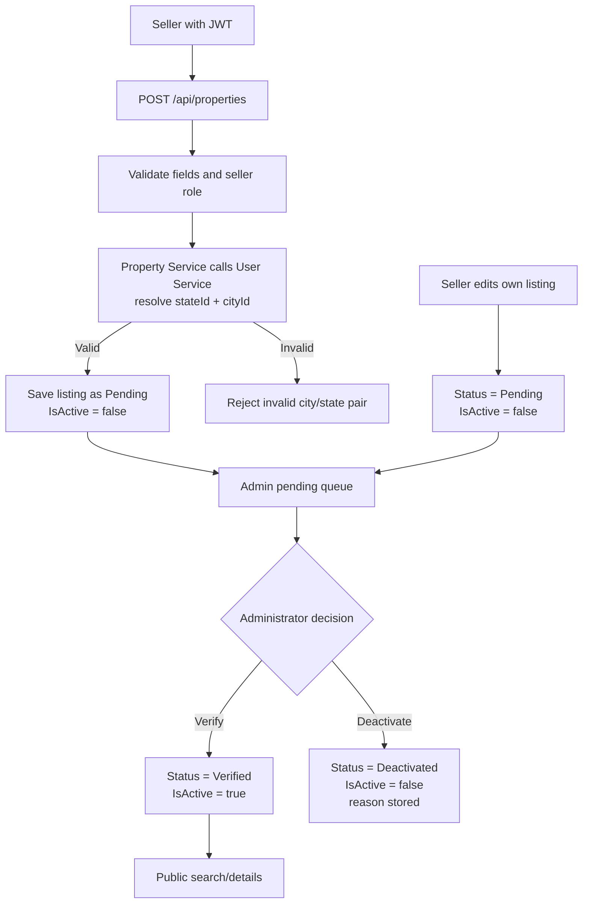
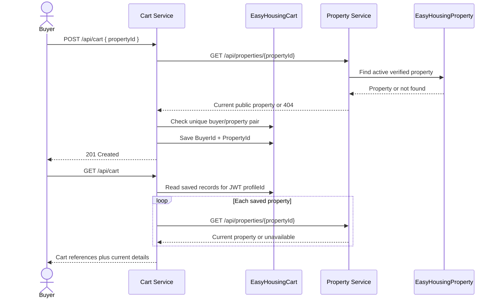

# EasyHousing Backend

EasyHousing is a property discovery and listing platform. This folder contains its .NET 8 backend: an API gateway and four independently hosted services for identity, user profiles/locations, property listings, and buyer saved homes.

This README is an implementation guide for developers, reviewers, and anyone learning the system. It explains how to start the application, what each service does, how requests move through the system, what data each database owns, and how the databases relate (and do not relate) to each other.

> **Important database fact:** each business service owns a separate SQL Server database. The databases do not connect directly to one another and contain no cross-database foreign keys. Services exchange identifiers and data over HTTP. The only relational foreign keys are within the User database (profile-to-location and city-to-state) and the Property database (property-to-image).

## Contents

- [Product overview](#product-overview)
- [What is in this repository](#what-is-in-this-repository)
- [Architecture at a glance](#architecture-at-a-glance)
- [Services and ports](#services-and-ports)
- [Database ownership and relationships](#database-ownership-and-relationships)
- [Database schemas](#database-schemas)
- [Prerequisites](#prerequisites)
- [Run the backend locally](#run-the-backend-locally)
- [Run the complete application](#run-the-complete-application)
- [Configuration](#configuration)
- [API gateway and routing](#api-gateway-and-routing)
- [API reference](#api-reference)
- [Authentication and authorization](#authentication-and-authorization)
- [Business workflows](#business-workflows)
- [Validation, status codes, and errors](#validation-status-codes-and-errors)
- [Images](#images)
- [Data initialization and schema changes](#data-initialization-and-schema-changes)
- [Swagger / OpenAPI](#swagger--openapi)
- [Testing and build](#testing-and-build)
- [Security and deployment notes](#security-and-deployment-notes)
- [Troubleshooting](#troubleshooting)
- [Known scope and limitations](#known-scope-and-limitations)
- [Design documents](#design-documents)

## Product overview

The backend supports three user roles:

| Role | Main capabilities |
|---|---|
| Visitor | Search active, verified listings and view public listing details |
| Buyer | Compare listings, view owner contact information, add/remove saved homes |
| Seller | Create and edit listings, upload listing images, view own listings |
| Admin | Review pending listings, verify listings, deactivate listings |

EasyHousing is a discovery and listing application, not a transaction processor. The current backend does not handle payments, escrow, offers, or legal transfer of ownership.

## What is in this repository

```text
backend/
|-- backendd.sln
|-- README.md
|-- docs/
|   |-- backendd-hld.tex       High-Level Design
|   `-- backendd-lld.tex       Low-Level Design
`-- services/
    |-- ApiGateway/
    |-- IdentityService/
    |-- UserService/
    |-- PropertyService/
    `-- CartService/
```

Each service is an ASP.NET Core project. Application code is under that service's `src/` directory, generally split into:

| Folder | Responsibility |
|---|---|
| `src/Controllers/` | HTTP binding, authorization attributes, claim extraction, HTTP status mapping |
| `src/Contracts/` | Request and response DTOs shared by controllers and application services |
| `src/Domain/` | Persisted entities and domain data |
| `src/Data/` | EF Core contexts plus repository interfaces and SQL-backed implementations |
| `src/Services/` | Application use cases and typed HTTP clients for other services |
| `src/Middleware/` | API exception translation |
| `Properties/launchSettings.json` | Local development launch profiles and ports |
| `appsettings.json` | Local connection strings, service URLs, JWT settings, CORS |

### Backend code layers



**Layer responsibilities and boundaries**

1. **Controllers** remain intentionally thin. They bind HTTP requests, apply route/role metadata, extract an authenticated profile ID from claims, call an application service, and translate its result to an HTTP response. Controllers must not query `DbContext`, build persisted entities, implement business validation, or orchestrate downstream calls.
2. **Application services** implement a user-visible use case. They validate business invariants, map request contracts into domain entities, coordinate repositories and typed service clients, apply lifecycle transitions, and map results into response contracts.
3. **Repository interfaces** express persistence operations needed by an application service without exposing EF queryables or database contexts.
4. **Repository implementations** encapsulate service-owned EF Core queries and writes. They contain database-specific concerns such as uniqueness violations and save operations.
5. **Typed HTTP clients** integrate with data owned by another service. They do not connect to that service's database.
6. **Contracts and domain entities** are distinct: contracts describe API/application input and output; domain entities represent persisted state.

Public controllers, application services, repositories, contracts, domain entities, and service clients have XML documentation comments. Comments should explain intent and non-obvious constraints rather than restating the identifier.

## Architecture at a glance



The gateway is a lightweight HTTP proxy. It selects a downstream service based on the first path segment, forwards the request and its headers/body, and returns the downstream response. It does not own business data and does not perform the role authorization itself.

### Request lifecycle

1. A user performs an action in the Angular UI.
2. The browser sends the request to the gateway on port `5200`.
3. The gateway maps the API path to a service and forwards the request.
4. The destination service authenticates/authorizes the request where required.
5. That service reads or writes its own database using Entity Framework Core.
6. If it needs data owned by another service, it makes an HTTP call to that service; it never queries the other service's database.
7. The service returns a JSON or no-content response through the gateway.

## Services and ports

| Service | Project | Port | Database | Responsibilities |
|---|---|---:|---|---|
| API Gateway | `services/ApiGateway` | `5200` | None | Browser-facing API proxy; development Swagger aggregation |
| Identity Service | `services/IdentityService` | `5201` | `EasyHousingIdentity` | Buyer/Seller registration, password hashing, login, JWT issue |
| User Service | `services/UserService` | `5202` | `EasyHousingUser` | Profiles, states, cities, internal location/contact/profile operations |
| Property Service | `services/PropertyService` | `5203` | `EasyHousingProperty` | Search, listing details, create/edit, images, verification, deactivation |
| Cart Service | `services/CartService` | `5204` | `EasyHousingCart` | Buyer saved-property records, duplicate prevention, live listing lookup |

All services use ASP.NET Core and Entity Framework Core. The business services use SQL Server through the configured LocalDB connection strings for local development.

## Database ownership and relationships

### How the databases are connected

The following diagram distinguishes **real SQL relationships** (solid arrows inside a database) from **logical cross-service references** (dashed arrows mediated by HTTP). A dashed line is not a foreign key or direct database connection.



### Runtime service connections between data owners

| Calling service | Owning service called | Reason | Example |
|---|---|---|---|
| Identity | User | Create the buyer/seller profile during registration; delete it as a compensation if account persistence conflicts | Direct to User Service: `POST /api/internal/users` |
| Identity | User | Delete a profile for registration compensation | Direct to User Service: `DELETE /api/internal/users/{userId}` |
| Property | User | Confirm that a submitted city belongs to the selected state and get the canonical region | Direct to User Service: `GET /api/internal/locations/resolve` |
| Property | User | Resolve private owner contact details after verifying the listing | Direct to User Service: `GET /api/internal/users/{userId}/contact` |
| Cart | Property | Confirm a listing is currently public and active; attach current listing data to saved items | `GET /api/properties/{propertyId}` |

These are synchronous HTTP calls. If the required destination service is unavailable, the operation that depends on it can fail. The services do not share a `DbContext`, connection string, or SQL transaction.

### What is a real foreign key?

**Real database foreign keys in the current EF model:**

- `EasyHousingUser.Cities.StateId` references `EasyHousingUser.States.StateId`.
- `EasyHousingUser.Users.StateId`, when present, references `EasyHousingUser.States.StateId`.
- `EasyHousingUser.Users.CityId`, when present, references `EasyHousingUser.Cities.CityId`.
- `EasyHousingProperty.PropertyImages.PropertyId` references `EasyHousingProperty.Properties.PropertyId`, with cascade delete.

**Logical references only (no cross-database foreign key):**

- `IdentityAccount.UserId` is the profile ID returned by User Service.
- `PropertyListing.SellerId` is the seller's `UserId` in User Service.
- `PropertyListing.StateId` and `CityId` correspond to IDs in User Service. The Property Service also stores the canonical region string.
- `SavedProperty.BuyerId` is the buyer's `UserId` in User Service.
- `SavedProperty.PropertyId` corresponds to `PropertyListing.PropertyId` in Property Service.

SQL Server cannot enforce these cross-database references through the current service-owned database design. The owning service and HTTP calls perform relevant validation. For example, Cart Service asks Property Service if a property is available before saving it.

## Database schemas

The table/column names below are logical names derived from the EF entities. EF Core uses conventions for table naming unless overridden.

### `EasyHousingIdentity`

Owned by Identity Service. Contains authentication credentials and role mapping, not profile/contact fields.

| Entity | Important fields and constraints |
|---|---|
| `IdentityAccount` | `IdentityAccountId` primary key; `UserName` unique and max 25; `PasswordHash` max 500; `UserType` max 15; `UserId` stores the corresponding profile identifier |

Passwords are stored as hashes using ASP.NET Core's `PasswordHasher<IdentityAccount>`. Plaintext passwords are not stored. The locally seeded `admin` account uses `UserId = 0`, since it has no ordinary profile row.

### `EasyHousingUser`

Owned by User Service. Contains user profile/PII and the location catalogue.

| Entity | Important fields and constraints |
|---|---|
| `UserProfile` | `UserId` primary key; username max 25 and unique; email max 50 and unique; user type; first/last name; date of birth; phone; optional address/state/city |
| `State` | `StateId` primary key; `StateName` max 30; has cities |
| `City` | `CityId` primary key; `CityName` max 50; required `StateId` foreign key |

State/city deletion behavior is restrictive: a referenced location cannot be removed while related rows exist. Seller profiles require address, state, and city. Buyer profiles may have null address/state/city.

Development seed catalogue:

| State | Cities |
|---|---|
| Gujarat | Ahmedabad, Surat |
| Maharashtra | Mumbai, Pune |
| Karnataka | Bengaluru |

### `EasyHousingProperty`

Owned by Property Service. Contains listing data and image bytes.

| Entity | Important fields and constraints |
|---|---|
| `PropertyListing` | `PropertyId` primary key; `PropertyName` max 50; `PropertyType` max 15; `PropertyOption` max 10; `Description` max 250; `Address` max 250; `Landmark` max 25; `Region`; `StateId`, `CityId`, `SellerId` external identifiers; price and deposit are `decimal(18,2)`; status, active flag, optional deactivation reason, creation timestamp |
| `PropertyImage` | `ImageId` primary key; `PropertyId` foreign key; binary image bytes; MIME content type |

Deleting a property cascades to its own image rows. Seller, state, city, and cart identifiers are not relational foreign keys in this database.

### `EasyHousingCart`

Owned by Cart Service. Stores saved-home references, not a copy of the full listing.

| Entity | Important fields and constraints |
|---|---|
| `SavedProperty` | `CartId` primary key; `BuyerId`; `PropertyId`; UTC `AddedAtUtc`; unique composite index on `(BuyerId, PropertyId)` |

At cart-read time, Cart Service requests current property data from Property Service. If a listing is no longer available, the cart response can include a null property instead of deleting the saved record automatically.

## Prerequisites

| Requirement | Purpose |
|---|---|
| .NET 8 SDK | Restore, build, and run the services |
| SQL Server LocalDB | Local SQL Server database engine |
| Visual Studio / VS Code / PowerShell | Optional development tools |
| Node.js and npm | Only needed to run the Angular frontend |

Verify the SDK:

```powershell
dotnet --info
```

Verify the solution is present:

```powershell
Get-ChildItem C:\Users\vrajpoot\dnet_practice\EasyHousingSolution\backend
```

## Run the backend locally

The simplest local setup is to start each service in its own PowerShell terminal. The commands below assume the current directory is the solution root (`EasyHousingSolution`):

```powershell
dotnet run --project backend\services\UserService\UserService.csproj --launch-profile http
```

```powershell
dotnet run --project backend\services\IdentityService\IdentityService.csproj --launch-profile http
```

```powershell
dotnet run --project backend\services\PropertyService\PropertyService.csproj --launch-profile http
```

```powershell
dotnet run --project backend\services\CartService\CartService.csproj --launch-profile http
```

```powershell
dotnet run --project backend\services\ApiGateway\ApiGateway.csproj --launch-profile http
```

If your terminal is already in the `backend` directory, use paths beginning with `services\` instead, for example:

```powershell
dotnet run --project services\IdentityService\IdentityService.csproj --launch-profile http
```

### Startup order

Recommended order:

1. User Service — profile/location dependency.
2. Identity Service — registration calls User Service.
3. Property Service — listing creation/contact lookup calls User Service.
4. Cart Service — cart actions call Property Service.
5. API Gateway — browser entry point.

The services can start independently, but dependent operations will not work until their downstream services are available.

### First startup

Each database-backed service calls Entity Framework Core `EnsureCreatedAsync()` on startup. User Service seeds its initial states/cities, and Identity Service creates the development administrator if it is missing.

Local development administrator:

| Username | Password |
|---|---|
| `admin` | `Admin@123` |

Do not use the development administrator credentials in a deployed environment.

## Run the complete application

1. Start the five backend processes above.
2. Open `http://localhost:5200/swagger` to confirm the gateway and downstream Swagger documents are available.
3. Open another terminal and go to the `frontend` folder.
4. Install frontend packages if needed with `npm install`.
5. Run `npm start`.
6. Browse to `http://localhost:4200`.

The Angular application calls `http://localhost:5200/api`.

## Configuration

### Connection strings

Each database-backed service reads its own named connection string from its configuration:

| Service | Configuration key | Local database name |
|---|---|---|
| Identity | `ConnectionStrings:IdentityDatabase` | `EasyHousingIdentity` |
| User | `ConnectionStrings:UserDatabase` | `EasyHousingUser` |
| Property | `ConnectionStrings:PropertyDatabase` | `EasyHousingProperty` |
| Cart | `ConnectionStrings:CartDatabase` | `EasyHousingCart` |

The checked-in local settings use SQL Server LocalDB and trusted Windows authentication. Configure each service independently for a different SQL Server host or database. Do not make multiple services point at the same database to simulate integration; they must continue to own their respective data.

### Service URLs

| Configuration location | URL key | Local target |
|---|---|---|
| API Gateway | `Services:IdentityService` | `http://localhost:5201` |
| API Gateway | `Services:UserService` | `http://localhost:5202` |
| API Gateway | `Services:PropertyService` | `http://localhost:5203` |
| API Gateway | `Services:CartService` | `http://localhost:5204` |
| Identity Service | `Services:UserService` | `http://localhost:5202/` |
| Property Service | `Services:UserService` | `http://localhost:5202/` |
| Cart Service | `Services:PropertyService` | `http://localhost:5203/` |

When deploying to containers or another host, replace `localhost` with the reachable internal DNS name/host for the target service. `localhost` inside a container means that same container, not another service container.

### JWT settings

Identity issues an eight-hour HMAC-SHA256 JWT with:

- Issuer
- Audience
- Signing key
- Username/name claim
- Role claim (`Buyer`, `Seller`, or `Admin`)
- `profileId` claim
- Expiry

Identity, User, Property, and Cart validate the JWT issuer, audience, signature, and lifetime using compatible configuration. The token lifetime validation allows a 30-second clock skew.

### Internal API key

Identity and Property call protected User Service operations with the `X-Internal-Api-Key` header. The value configured for those callers must match User Service's configured internal key.

Treat all checked-in settings as development configuration only. Provide unique production secrets through a secret manager, environment variables, or secure deployment configuration. Do not commit credentials or signing keys.

### CORS

The services and gateway read allowed browser origins from `Cors:Origins`. The local configuration permits `http://localhost:4200`. If the frontend uses a different scheme, hostname, or port, configure that exact origin. `localhost` and `127.0.0.1` are different browser origins.

## API gateway and routing

The gateway forwards these path prefixes:

| Incoming gateway path | Destination |
|---|---|
| `/api/identity/...` | Identity Service |
| `/api/locations/...` | User Service |
| `/api/properties/...` | Property Service |
| `/api/cart/...` | Cart Service |

The gateway preserves the query string, forwards request bodies (including multipart uploads), forwards most headers, and returns the downstream status and body. Unknown API prefixes return `404`.

The gateway also provides a development Swagger UI. In the current implementation it does not add retries, circuit breakers, API version negotiation, request rate limiting, role enforcement, or health aggregation.

## API reference

Gateway API paths below are relative to `http://localhost:5200`. Protected endpoints require `Authorization: Bearer <JWT>` with the role shown. The gateway forwards the Authorization header. Internal User Service paths are the exception: Identity and Property call them directly at `http://localhost:5202`, with the configured `X-Internal-Api-Key`; the gateway does not proxy `/api/internal/...`.

### Identity Service

| Method | Path | Access | Purpose |
|---|---|---|---|
| `POST` | `/api/identity/register` | Public | Create Buyer or Seller account and profile |
| `POST` | `/api/identity/login` | Public | Verify credentials and return an access token/session |

Registration request fields:

| Field | Constraints / notes |
|---|---|
| `userName` | Required, 1–25 characters; trimmed; unique |
| `password` | Required, 8–25 characters |
| `userType` | Exactly `Buyer` or `Seller` |
| `firstName` | Required, max 25 |
| `lastName` | Max 25 |
| `emailId` | Required valid email, max 50; unique in profile store |
| `phoneNo` | Required; exactly 10 digits |
| `dateOfBirth` | Must be set and in the past |
| `address` | Max 250; required for Seller by User Service |
| `stateId`, `cityId` | Required for Seller; city must belong to selected state |

Successful login returns `userName`, `userType`, `profileId`, and `token`.

### User Service

| Method | Path | Access | Purpose |
|---|---|---|---|
| `GET` | `/api/locations/states` | Public | List states alphabetically |
| `GET` | `/api/locations/states/{stateId}/cities` | Public | List cities in a state |
| `GET` | `http://localhost:5202/api/internal/locations/resolve?stateId={id}&cityId={id}` | Internal API key | Validate pair and return canonical `"City, State"` region |
| `POST` | `http://localhost:5202/api/internal/users` | Internal API key | Create Buyer/Seller profile |
| `DELETE` | `http://localhost:5202/api/internal/users/{userId}` | Internal API key | Delete profile for registration compensation |
| `GET` | `http://localhost:5202/api/internal/users/{userId}/contact` | Internal API key | Return owner name, email and phone |

The public location endpoints are intended for registration and property forms. Internal profile and contact endpoints require the configured `X-Internal-Api-Key`.

### Property Service

| Method | Path | Access | Purpose |
|---|---|---|---|
| `GET` | `/api/properties/search` | Public | Search active verified listings |
| `GET` | `/api/properties/{propertyId}` | Public | Get one active verified listing |
| `GET` | `/api/properties/compare?id1={id}&id2={id}` | Buyer | Compare two different active verified listings |
| `GET` | `/api/properties/{propertyId}/contact` | Buyer | Resolve listing owner's contact information |
| `POST` | `/api/properties` | Seller | Submit a new listing |
| `PUT` | `/api/properties/{propertyId}` | Seller (must own listing) | Edit own listing and send it back for review |
| `POST` | `/api/properties/{propertyId}/images` | Seller (must own listing) | Upload listing image files |
| `GET` | `/api/properties/mine?status=Verified` | Seller | Get own verified active listings |
| `GET` | `/api/properties/mine` | Seller | Get own unverified/inactive listings |
| `GET` | `/api/properties/admin/pending` | Admin | List pending properties |
| `GET` | `/api/properties/admin/region/{region}` | Admin | Search by region substring |
| `GET` | `/api/properties/admin/owner/{sellerId}` | Admin | List properties for a seller profile |
| `PUT` | `/api/properties/admin/{propertyId}/verify` | Admin | Mark listing verified and active |
| `PUT` | `/api/properties/admin/{propertyId}/deactivate` | Admin | Deactivate listing with a reason |

Search query parameters:

| Parameter | Effect |
|---|---|
| `region` | Case/database collation-dependent substring match against normalized region |
| `type` | Exact property type match |
| `option` | Exact `Sell` or `Rent` match |
| `sortBy=price_asc` | Lowest price first |
| `sortBy=price_desc` | Highest price first |
| omitted/other `sortBy` | Property name ascending |

Property submission fields are `propertyName`, `propertyType`, `propertyOption`, `description`, `address`, `stateId`, `cityId`, `priceRange`, `initialDeposit`, and `landmark`. Listing types are accepted as strings; the `propertyOption` must be exactly `Sell` or `Rent`.

### Cart Service

| Method | Path | Access | Purpose |
|---|---|---|---|
| `GET` | `/api/cart` | Buyer | List current buyer saved items with current property details |
| `POST` | `/api/cart` | Buyer | Save an active verified property |
| `DELETE` | `/api/cart/{cartId}` | Buyer (must own cart item) | Remove a saved item |

Add request:

```json
{
  "propertyId": 123
}
```

Cart ownership is determined from the JWT `profileId` claim; the client does not choose the buyer ID in the request.

### Typical response conventions

- Login returns `200 OK`.
- Registration returns `201 Created`.
- Property creation returns `201 Created` with a property ID and message.
- Successful update, verify, deactivate, and cart removal commonly return `204 No Content`.
- Invalid input returns `400 Bad Request`.
- Invalid credentials or rejected internal API key returns `401 Unauthorized`.
- Role mismatch is rejected by ASP.NET Core authorization, typically `403 Forbidden`.
- Duplicate username/cart item returns `409 Conflict`.
- Missing or unavailable listing/profile returns `404 Not Found`.

Exact response bodies are endpoint-specific; use Swagger for the live OpenAPI contract.

## Authentication and authorization



### Authorization matrix

| Operation | Anonymous | Buyer | Seller | Admin |
|---|:---:|:---:|:---:|:---:|
| Public listing search/details | Yes | Yes | Yes | Yes |
| Listing compare | No | Yes | No | No |
| View owner contact | No | Yes | No | No |
| Read/add/remove cart | No | Yes | No | No |
| Create/update/upload property | No | No | Yes | No |
| Read own properties | No | No | Yes | No |
| Admin property search/moderation | No | No | No | Yes |
| Internal user profile/contact operations | Internal API key | Internal API key | Internal API key | Internal API key |

The API Gateway is not the authorization boundary. Protected controllers validate JWT roles and derive the relevant profile ID from the token. User Service's internal endpoints use the API key. Keep all services inaccessible to untrusted networks in a production deployment, or add appropriate service-to-service network controls.

## Business workflows

### Registration and profile/account relationship

Identity and User have separate stores. The profile is created first, and its generated `UserId` is saved in `IdentityAccount.UserId`. This is a logical relationship across databases.



The compensating profile deletion handles the Identity database update conflict case implemented by the service. This is not a distributed database transaction; broader distributed rollback/retry behavior is not implemented.

### Listing creation and moderation



Only active listings with `Status == "Verified"` are returned by public search, public details, comparison, and owner-contact lookup. Editing a listing resets it to Pending and inactive, requiring administrator verification again.

### Buyer save and cart read



The unique composite index prevents duplicate `(BuyerId, PropertyId)` rows. Cart Service verifies availability through Property Service before inserting; the property record is not duplicated into the cart database.

## Validation, status codes, and errors

### Main server-side validations

| Area | Validation |
|---|---|
| Identity registration | Username 1–25, password 8–25, Buyer/Seller role only, valid past date of birth, email format/max 50, exactly 10 phone digits |
| Profile creation | Username/email uniqueness; Seller must provide address/state/city; city must belong to selected state |
| Property create/update | Required text fields and maximum lengths; `Sell`/`Rent`; positive price; non-negative deposit; valid state/city resolved from User Service |
| Image upload | At least one file; no more than six images total per property; JPEG/PNG/WebP; each file 1–5,000,000 bytes |
| Comparison | Two positive, distinct IDs; both listings must still be active and verified |
| Cart add | Positive property ID; property must be available; buyer/property pair must not already exist |
| Deactivation | Non-empty reason; reason stored on the listing |

### Error behavior

Each business service registers `ApiExceptionMiddleware`, which translates exceptions into API responses. The detailed low-level design and Swagger contract should be consulted for response shape. Clients should not assume every error is returned with the same JSON casing or message envelope.

Expected examples:

- `400`: invalid request data, bad location pair, invalid image content/size, or missing deactivation reason.
- `401`: invalid login or invalid/missing internal API key.
- `403`: valid JWT without the required role.
- `404`: listing/profile/cart entry not found or listing not publicly available.
- `409`: duplicate username or duplicate saved property.
- `5xx`: unhandled downstream, database, or runtime failure.

Cross-service calls are synchronous and use `EnsureSuccessStatusCode()` for unexpected unsuccessful responses. A downstream outage can therefore fail the originating operation.

## Images

- Images belong to Property Service and are stored as byte arrays in the Property database.
- Upload endpoint accepts multipart form data with one or more files named `files`.
- Accepted content types: `image/jpeg`, `image/png`, and `image/webp`.
- Maximum file size: 5 MB per file.
- Maximum number: six images per property across uploads.
- The upload endpoint has a 32,000,000-byte request size limit.
- Property DTOs serialize the image bytes as Base64 alongside `contentType`.
- The frontend converts Base64 values into data URLs.
- Images are deleted with their property via the configured cascade relationship.

There is no object-storage service or thumbnail pipeline in the current implementation. Returning Base64 images in listing responses increases response payload size.

## Data initialization and schema changes

### Current database initialization

On service startup, Identity, User, Property, and Cart call EF Core `EnsureCreatedAsync()`. In addition:

- Identity creates the `admin` account if it does not exist.
- User ensures the initial states and cities exist.
- Property and Cart currently create their schema but do not seed example listings/cart records.

`EnsureCreatedAsync()` is convenient for a fresh local database, but it does not provide versioned incremental schema migrations. Treat schema changes carefully when a local database already contains data. Production should use reviewed EF Core migrations, backups, and a deployment migration procedure.

### Resetting local data

Deleting a LocalDB database removes its data, including users, listings, and saved homes. Do not do this against data you need to keep. Prefer supported database tooling to inspect or back up LocalDB before resetting.

## Swagger / OpenAPI

Start the gateway and all four business services, then visit:

- Gateway Swagger UI: `http://localhost:5200/swagger`
- Identity Swagger UI: `http://localhost:5201/swagger`
- User Swagger UI: `http://localhost:5202/swagger`
- Property Swagger UI: `http://localhost:5203/swagger`
- Cart Swagger UI: `http://localhost:5204/swagger`

The gateway's development Swagger dropdown reads proxied OpenAPI JSON from:

| Gateway document endpoint | Downstream |
|---|---|
| `/swagger/identity/swagger.json` | Identity |
| `/swagger/users/swagger.json` | User |
| `/swagger/properties/swagger.json` | Property |
| `/swagger/cart/swagger.json` | Cart |

The four service projects generate XML documentation files during build and load those comments into their Swagger definitions, so endpoint summaries and request/response types are documented in the interactive API reference as well as in source.

Swagger is enabled when the service environment is `Development`. The launch profile `http` sets this environment for local use.

## Testing and build

Build the complete backend solution from the backend directory:

```powershell
dotnet build backendd.sln
```

Or build a specific service project:

```powershell
dotnet build services\PropertyService\PropertyService.csproj
```

Run tests if/when test projects are added to the solution:

```powershell
dotnet test backendd.sln
```

The current backend layout does not include dedicated service test projects. Recommended test coverage includes:

- Unit tests for registration validation, password verification, and JWT claims.
- Integration tests for role authorization and endpoint response contracts.
- Database tests for uniqueness, cascade deletion, and state/city integrity.
- Service-contract tests for Identity→User, Property→User, and Cart→Property calls.
- Image upload tests for limits, media types, ownership, and Base64 DTO output.
- Lifecycle tests ensuring unverified/deactivated listings are not returned publicly.

## Security and deployment notes

This project configuration is for local development; it is not production-ready as-is.

1. **Secrets:** replace development JWT signing keys and the internal API key with strong, unique secrets supplied by a secure secret store.
2. **Administrator:** replace the seeded local administrator credentials before any non-local deployment; do not rely on the development seed account.
3. **HTTPS:** terminate TLS for browser traffic and secure service-to-service traffic where required.
4. **Network boundaries:** do not expose internal service ports unnecessarily. The gateway is a proxy, not a full API security gateway.
5. **Authorization:** retain server-side role checks; frontend route guards are not security controls.
6. **Internal API key:** protect it as a shared secret and restrict which services can reach User Service's internal operations.
7. **Browser storage:** the frontend stores the JWT in local storage, so production must mitigate XSS and assess token storage trade-offs.
8. **Uploads:** validate/scan files and consider object storage, quotas, and image processing before exposing uploads publicly.
9. **Operations:** add health checks, timeouts, retries/circuit breakers where appropriate, structured logs, correlation IDs, monitoring, backups, and database migrations.
10. **Data protection:** profile data includes email, phone, and date of birth; apply appropriate access controls, retention, and privacy handling.

Do not copy the development secrets from `appsettings.json` into production. Configure secret values externally.

## Troubleshooting

### A service cannot connect to LocalDB

- Confirm SQL Server LocalDB is installed.
- Confirm `(localdb)\mssqllocaldb` is accessible under the current Windows user.
- Check the service's own `ConnectionStrings` key in its `appsettings.json`.
- Run one service at a time to identify which database connection fails.

### Gateway returns 404

- Confirm the gateway is listening on port `5200`.
- Check the route prefix: `identity`, `locations`, `properties`, or `cart`.
- Confirm the destination service URL in gateway configuration and that the service is running.
- Remember that Swagger is only available in Development.

### Registration fails while creating a profile

- Start User Service before Identity Service.
- Confirm Identity's `Services:UserService` points at port `5202`.
- Confirm both services use the same internal API key setting.
- Check username/email uniqueness and Seller address/state/city requirements.

### Seller listing submission rejects location

- Start User Service.
- Use a state and a city returned by `/api/locations/states` and `/api/locations/states/{id}/cities`.
- The city must belong to the selected state; Property Service resolves and validates this before writing its own database.

### Cart endpoints return unauthorized

- Sign in as a Buyer and send the returned JWT as a Bearer token.
- Check the token's role and `profileId` claims.
- Seller/Admin roles cannot access Cart endpoints.

### Property does not show in public search

Public queries include only listings with both `Status == "Verified"` and `IsActive == true`. A new submission is pending and hidden until an Admin verifies it. Edits return listings to review.

### Cart item has no property details

Cart stores only IDs. If Property Service returns `404` for a no-longer-public listing, Cart may return that saved reference with a null property. The buyer can remove the stale saved entry.

### Browser reports CORS failure

- Confirm `http://localhost:4200` appears in the configured CORS origins.
- Ensure the frontend calls the gateway on `http://localhost:5200`.
- Do not switch to `127.0.0.1` unless it is also configured.

## Known scope and limitations

- No payment, purchase workflow, escrow, or title transfer.
- No shared database, distributed transaction, message broker, or event bus.
- No automatic cleanup of cart records when a listing becomes unavailable.
- No production object storage, image resizing, thumbnail generation, or malware scanning.
- No implemented pagination for property search.
- No gateway retry, circuit breaker, distributed tracing, or rate limiting.
- Schema creation uses `EnsureCreatedAsync()` rather than versioned migrations.
- Cross-service calls are synchronous HTTP calls.
- LocalDB, local ports, development Swagger, and checked-in local configuration are intended for development.

## Design documents

- [High-Level Design](docs/backendd-hld.tex) — service boundaries, runtime topology, trust boundaries, data ownership, quality attributes, and evolution.
- [Low-Level Design](docs/backendd-lld.tex) — detailed endpoints, payloads, validation, persistence, and implementation behavior.
- [Frontend README](../frontend/README.md) — Angular setup, routes, UI workflows, frontend API usage, and SSR build.

The LaTeX sources can be compiled with a LaTeX installation from the `backend\docs` directory. Run each command twice to populate the table of contents:

```powershell
pdflatex -interaction=nonstopmode -halt-on-error backendd-hld.tex
pdflatex -interaction=nonstopmode -halt-on-error backendd-lld.tex
```
