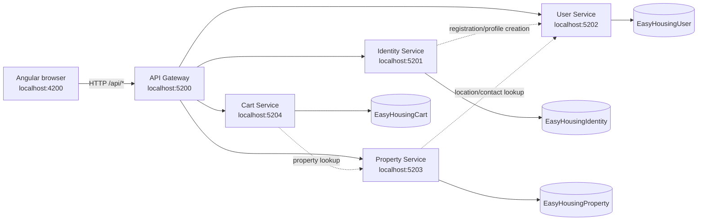
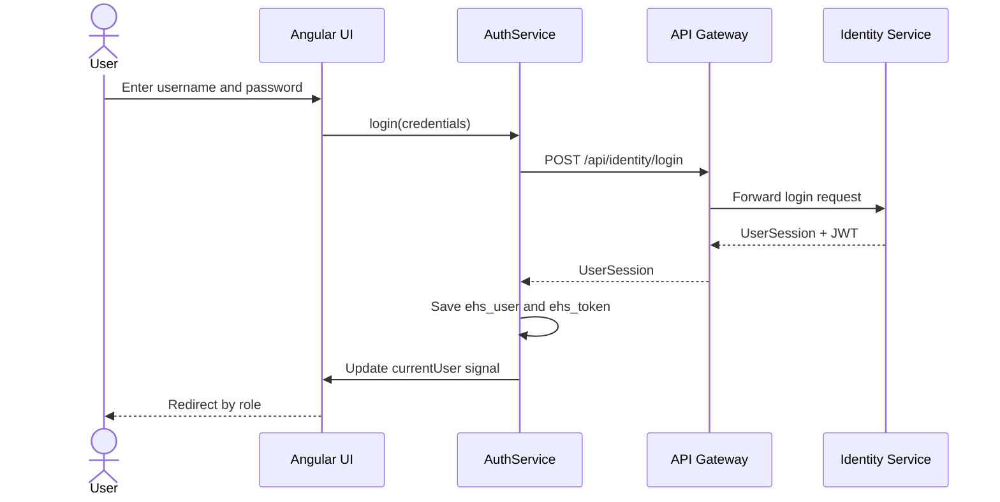
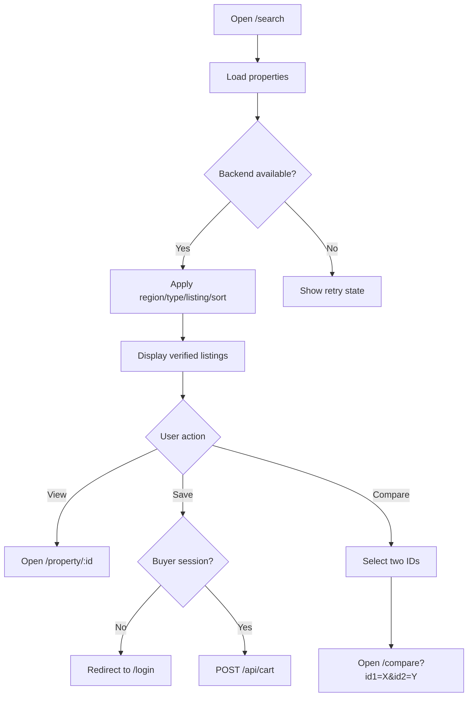
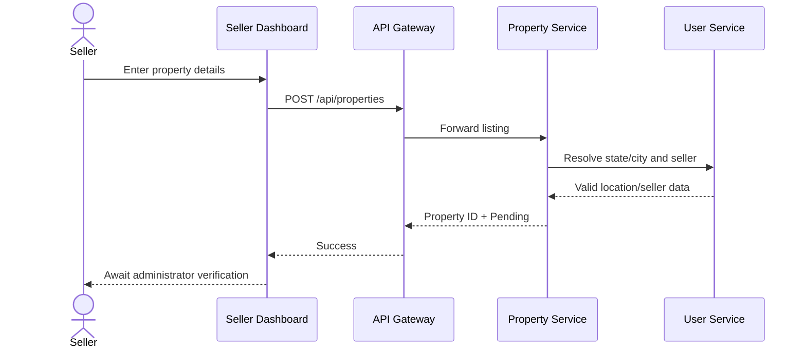
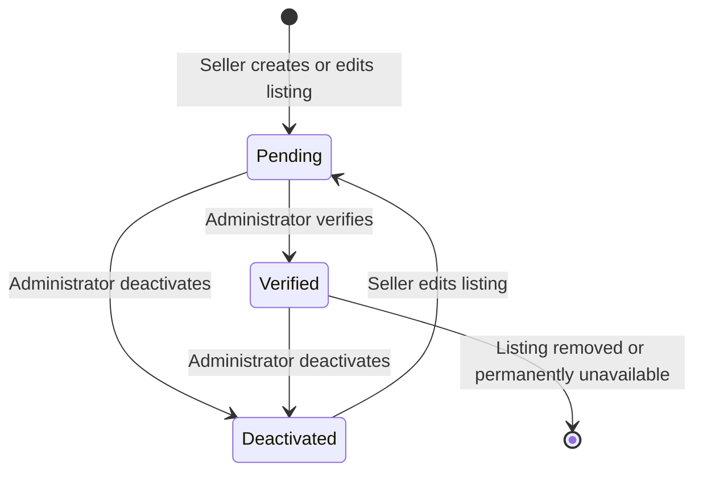

# EasyHousing Frontend

<p>
  
</p>

EasyHousing is a full-stack property discovery and listing platform. The Angular frontend lets buyers find homes, inspect listings, compare two properties, save them to a personal shortlist, and reveal owner contact details. Sellers can publish and maintain listings, while administrators verify or deactivate properties.

This document describes the frontend repository and the complete local system, including prerequisites, architecture, routes, role permissions, API integration, data structures, validation, testing, and deployment behavior.

## Table of contents

- [Project at a glance](#project-at-a-glance)
- [Core user journeys](#core-user-journeys)
- [System architecture](#system-architecture)
- [Technology stack](#technology-stack)
- [Repository structure](#repository-structure)
- [Prerequisites](#prerequisites)
- [Installation](#installation)
- [Running the application](#running-the-application)
- [Configuration](#configuration)
- [Application routes](#application-routes)
- [Frontend feature guide](#frontend-feature-guide)
- [Authentication and authorization](#authentication-and-authorization)
- [API integration](#api-integration)
- [Main TypeScript models](#main-typescript-models)
- [User flows and diagrams](#user-flows-and-diagrams)
- [Form behavior and validation](#form-behavior-and-validation)
- [Image handling](#image-handling)
- [Testing](#testing)
- [Production build and SSR](#production-build-and-ssr)
- [Backend setup summary](#backend-setup-summary)
- [Troubleshooting](#troubleshooting)
- [Current scope and limitations](#current-scope-and-limitations)
- [Useful commands](#useful-commands)
- [Design references](#design-references)

## Project at a glance

| Area | Details |
|---|---|
| Application name | EasyHousing |
| Frontend framework | Angular 22 with standalone components |
| UI style | Responsive, single-page application |
| Rendering | Browser application with Angular SSR configured |
| State management | Angular signals and RxJS observables |
| API base URL | `http://localhost:5200/api` |
| Frontend URL | `http://localhost:4200` |
| Supported roles | Buyer, Seller, Admin |
| Listing types | Sale (`Sell`) or rental (`Rent`) |
| Property types | Flat, Villa, Plot |

## Core user journeys

### Buyer

1. Opens the Explore Homes page.
2. Searches by region, property type, listing option, and sort order.
3. Opens a property for complete details.
4. Optionally reveals verified owner contact information.
5. Saves homes to a personal shortlist.
6. Removes saved homes from the shortlist.
7. Selects two properties and compares price, deposit, landmark, and address side by side.

### Seller

1. Registers a seller account or signs in.
2. Opens the My Listings dashboard.
3. Creates a property with location, price, deposit, and description.
4. Uploads up to six photos at a time.
5. Reviews verified and pending/deactivated listings.
6. Edits submitted listings; edited listings are sent back for review.

### Administrator

1. Signs in with an administrator account.
2. Reviews properties awaiting approval.
3. Searches listings by region or seller profile ID.
4. Verifies a listing to publish it to buyers.
5. Deactivates a listing with a mandatory reason.

## System architecture



### Component responsibilities

| Component | Responsibility |
|---|---|
| Angular frontend | Search UI, forms, route guarding, session state, HTTP interceptors, responsive presentation |
| API gateway | Single public API origin and path-based routing to downstream services |
| Identity service | Registration, credential verification, password hashing, JWT issuance |
| User service | Buyer/seller profiles, state/city catalogue, contact lookup support |
| Property service | Property lifecycle, search, details, images, verification, deactivation |
| Cart service | Buyer saved-property records and removal |

The services do not share relational tables. Data is exchanged through HTTP. Each service owns a separate SQL Server database.

## Technology stack

### Frontend

- Angular `^22.2.0`
- Angular Router
- Angular standalone components
- Angular forms
- RxJS `~7.8.0`
- Signals for local and session-derived reactive state
- Angular SSR and Express `^5.1.0`
- Vitest and Angular unit-test tooling
- TypeScript `~6.0.2`
- Google Fonts for DM Sans and Manrope

### Backend

- .NET 8
- ASP.NET Core Web API
- Microservice architecture
- JWT authentication
- SQL Server LocalDB for local development
- Swagger/OpenAPI

## Repository structure

```text
frontend/
|-- angular.json                 Angular workspace/build/SSR configuration
|-- package.json                npm scripts and dependencies
|-- public/
|   |-- favicon.ico
|   `-- property-placeholder.svg
`-- src/
    |-- index.html
    |-- main.ts                 Browser bootstrap
    |-- main.server.ts          SSR bootstrap
    |-- server.ts               Express SSR server
    |-- styles.css              Shared design system and responsive CSS
    `-- app/
        |-- app.ts              Root shell and footer
        |-- app.routes.ts       Public and role-protected routes
        |-- app.config.ts       Router and HTTP interceptor providers
        |-- core/
        |   |-- api.config.ts
        |   |-- guards/
        |   |-- interceptors/
        |   |-- models/
        |   |-- services/
        |   `-- utils/
        `-- features/
            |-- admin/
            |-- auth/
            |-- buyer/
            `-- shared/
```

### Core folder details

| Path | Purpose |
|---|---|
| `core/api.config.ts` | Defines the gateway base URL |
| `core/services/auth.service.ts` | Login, registration, logout, browser session and JWT storage |
| `core/services/property.service.ts` | Property, owner contact, search, comparison and cart endpoints |
| `core/services/location.service.ts` | State and city catalogue endpoints |
| `core/guards/role.guard.ts` | Prevents access to routes requiring another role |
| `core/interceptors/auth.interceptor.ts` | Adds the JWT to API requests |
| `core/interceptors/error.interceptor.ts` | Routes selected network/server responses to the error page |
| `core/models/ehs.models.ts` | Shared TypeScript interfaces |
| `core/utils/property-image.ts` | Converts stored image values or fallbacks to browser image URLs |

## Prerequisites

Install the following before setup:

| Requirement | Purpose |
|---|---|
| Node.js 20 or newer | Runs the Angular CLI and npm |
| npm | Installs frontend dependencies and executes scripts |
| Angular CLI 22 or newer | Optional global CLI convenience; npm scripts use the local CLI |
| .NET 8 SDK | Builds and runs the backend microservices |
| SQL Server LocalDB | Stores development database data |
| Windows PowerShell | Recommended commands in this environment |

The frontend and each backend service use fixed local ports. Make sure ports `4200`, `5200`, `5201`, `5202`, `5203`, and `5204` are available.

## Installation

### 1. Install frontend dependencies

```powershell
cd C:\Users\vrajpoot\dnet_practice\EasyHousingSolution\frontend
npm install
```

If `package-lock.json` exists, `npm ci` is preferable for a clean reproducible install.

```powershell
npm ci
```

### 2. Confirm the API origin

The frontend currently uses:

```ts
export const API_BASE_URL = 'http://localhost:5200/api';
```

It is declared in `src/app/core/api.config.ts`. Change this value only if the gateway uses another origin or port.

### 3. Start the backend

Use separate terminals from the solution root.

```powershell
dotnet run --project backend\services\UserService\UserService.csproj --launch-profile http
dotnet run --project backend\services\IdentityService\IdentityService.csproj --launch-profile http
dotnet run --project backend\services\PropertyService\PropertyService.csproj --launch-profile http
dotnet run --project backend\services\CartService\CartService.csproj --launch-profile http
dotnet run --project backend\services\ApiGateway\ApiGateway.csproj --launch-profile http
```

### 4. Start the frontend

```powershell
npm start
```

Open `http://localhost:4200`.

## Running the application

| Script | Command | Purpose |
|---|---|---|
| Development server | `npm start` | Starts Angular on port `4200` |
| Production build | `npm run build` | Produces browser and SSR output in `dist/` |
| Watch build | `npm run watch` | Rebuilds while source files change |
| Unit tests | `npm test` | Runs Angular/Vitest unit tests |
| SSR server | `npm run serve:ssr:frontend` | Starts the built SSR Express server |

The backend development gateway is available at `http://localhost:5200/api`; Swagger is normally available at `http://localhost:5200/swagger`.

## Configuration

### Frontend API configuration

The API origin is defined centrally in `api.config.ts`. Every API service imports `API_BASE_URL`, so changing the gateway origin should not require editing every endpoint.

### Development storage

After login, the browser stores:

| Key | Value |
|---|---|
| `ehs_user` | Username, role, profile ID and token as JSON |
| `ehs_token` | JWT used by the auth interceptor |

Both values are browser `localStorage` values. Signing out removes both keys and resets the reactive current-user signal.

During server-side rendering, session access is bypassed with Angular's `isPlatformBrowser` check. This prevents SSR code from directly depending on browser-only `localStorage`.

### Backend development ports

| Service | Port |
|---|---|
| API gateway | `5200` |
| Identity | `5201` |
| User | `5202` |
| Property | `5203` |
| Cart | `5204` |

## Application routes

| Path | Component | Access |
|---|---|---|
| `/` | Redirect | Redirects to `/search` |
| `/search` | `PropertySearchComponent` | Public |
| `/property/:id` | `PropertyDetailsComponent` | Public; contact and saving require Buyer role |
| `/login` | `LoginComponent` | Public |
| `/register` | `RegisterComponent` | Public |
| `/compare?id1=...&id2=...` | `ComparePropertiesComponent` | Buyer only |
| `/cart` | `CartComponent` | Buyer only |
| `/seller` | `SellerDashboardComponent` | Seller only |
| `/admin` | `AdminDashboardComponent` | Admin only |
| `/error` | `ErrorPageComponent` | Public |
| Unknown path | Wildcard | Redirects to `/error` |

The role guard reads `AuthService.currentUser()`. A missing session redirects to `/login`. An authenticated user requesting a route for another role is sent to `/error` with status `403`.

## Frontend feature guide

### Explore Homes

- Searches by free-text region.
- Filters by property type: Flat, Villa, or Plot.
- Filters by listing option: Sell or Rent.
- Sorts by recommended, lowest price, or highest price.
- Displays the first stored listing image or the property placeholder.
- Allows adding a property to the Buyer shortlist.
- Allows selecting exactly two properties for comparison.
- Handles API outages as a visible inline search error rather than an application crash.

### Property Details

- Loads a listing using the numeric `:id` route parameter.
- Shows name, type, sale/rental mode, price, deposit, region, address, landmark, and description.
- Buyer users can reveal owner name, email, and phone.
- Non-Buyers are redirected to login for protected buyer actions.
- Buyer users can save the property to their cart.
- Already-saved properties receive an appropriate duplicate-message response.

### Compare Properties

- Reads `id1` and `id2` query parameters.
- Rejects missing, non-integer, negative, or identical IDs.
- Requests both listings in one comparison call.
- Displays only two valid properties in a side-by-side layout.

### Saved Homes

- Loads saved property references for the logged-in Buyer profile.
- Shows an unavailable-property state if a listing no longer exists or was removed.
- Removes individual saved records by cart ID.
- Links back to listing details or the Explore Homes page.

### Registration

Supports Buyer and Seller account types.

Buyer fields:

- Username
- Password
- First name
- Last name
- Email
- Phone number
- Date of birth

Seller fields include all Buyer fields plus:

- Street address
- State
- City

State selection loads cities dynamically. A Seller cannot submit until both a valid state and city are chosen.

### Seller Dashboard

- Loads verified listings and pending/deactivated listings.
- Creates new property submissions.
- Edits existing property submissions.
- Submits property details with state and city IDs.
- Uploads image files with `multipart/form-data`.
- Allows at most six files per upload request.
- Refreshes listing lists after create, edit, and image-upload actions.

After create or edit, the listing is represented as Pending or sent for review by the backend moderation process.

### Admin Dashboard

- Displays a pending verification queue.
- Refreshes pending listings.
- Searches by region.
- Searches by seller/owner ID.
- Verifies pending properties.
- Deactivates properties with a required reason.
- Reports success or error through inline notices.

## Authentication and authorization



The frontend role matrix is:

| Action | Buyer | Seller | Admin |
|---|:---:|:---:|:---:|
| Search listings | Yes | Yes | Yes |
| View property details | Yes | Yes | Yes |
| Reveal owner contact | Yes | No | No |
| Save property | Yes | No | No |
| Compare properties | Yes | No | No |
| Create/edit listings | No | Yes | No |
| Verify/deactivate listings | No | No | Yes |

The role guard is user experience protection and not a substitute for backend authorization. Backend endpoints must validate both the JWT and role independently.

## API integration

All public frontend calls use `http://localhost:5200/api`.

| Method | Endpoint | Frontend use |
|---|---|---|
| `POST` | `/identity/login` | Login |
| `POST` | `/identity/register` | Buyer or Seller registration |
| `GET` | `/locations/states` | Load registration/seller states |
| `GET` | `/locations/states/{stateId}/cities` | Load state-specific cities |
| `GET` | `/properties/search` | Search and filter properties |
| `GET` | `/properties/{id}` | Load property details |
| `GET` | `/properties/{id}/contact` | Load owner contact for Buyer |
| `GET` | `/properties/compare?id1={id}&id2={id}` | Load comparison properties |
| `POST` | `/properties` | Seller creates a property |
| `PUT` | `/properties/{id}` | Seller edits a property |
| `POST` | `/properties/{id}/images` | Upload property images |
| `GET` | `/properties/mine` | Seller listing queries |
| `GET` | `/properties/admin/pending` | Admin verification queue |
| `GET` | `/properties/admin/region/{region}` | Admin region search |
| `GET` | `/properties/admin/owner/{sellerId}` | Admin owner search |
| `PUT` | `/properties/admin/{id}/verify` | Admin verifies listing |
| `PUT` | `/properties/admin/{id}/deactivate` | Admin deactivates listing |
| `POST` | `/cart` | Add saved property |
| `GET` | `/cart` | Load saved properties |
| `DELETE` | `/cart/{cartId}` | Remove saved property |

### HTTP interceptors

The auth interceptor applies the JWT to requests beginning with `API_BASE_URL`.

The error interceptor handles failures as follows:

- Property search requests keep their own inline loading/error UI.
- HTTP `404`, status `0`, and HTTP `5xx` responses navigate to `/error`.
- Validation and inline API errors can remain in the current feature and are handled locally.

## Main TypeScript models

### `UserSession`

```ts
interface UserSession {
  userName: string;
  userType: 'Admin' | 'Seller' | 'Buyer';
  profileId: number | null;
  token: string;
}
```

### `Property`

```ts
interface Property {
  propertyId?: number;
  propertyName: string;
  propertyType: string;
  propertyOption: 'Sell' | 'Rent';
  description?: string;
  address: string;
  region: string;
  priceRange: number;
  initialDeposit: number;
  landmark: string;
  isActive?: boolean;
  deactivationReason?: string;
  status?: 'Pending' | 'Verified' | 'Deactivated' | string;
  sellerId: number;
  images?: PropertyImage[];
}
```

### `PropertySubmission`

Submitted property fields include `propertyName`, `propertyType`, `propertyOption`, `description`, `address`, `stateId`, `cityId`, `priceRange`, `initialDeposit`, and `landmark`.

### `OwnerContact`

```ts
interface OwnerContact {
  ownerName: string;
  emailId: string;
  phoneNo: string;
}
```

### `CartItem`

```ts
interface CartItem {
  cartId: number;
  buyerId: number;
  propertyId: number;
  property?: Property | null;
}
```

## User flows and diagrams

### Property search flow



### Seller publishing flow



### Moderation flow



The exact backend status transition rules are also enforced in the .NET services.

## Form behavior and validation

### Login

- Both username and password are required.
- Submission is disabled while the request is in progress.
- API error messages are shown inline.

### Registration

- Username and name fields enforce frontend length constraints.
- Password fields accept 8–25 characters.
- Email uses Angular email validation.
- Phone number is validated to the intended 10-digit format.
- Date of birth cannot be later than today's date.
- Seller state and city IDs must be selected.
- City options reset when state selection changes.

### Seller property form

- Property name, type, sale/rental option, address, location, price, and deposit are required where modeled in the form.
- State and city IDs are converted to a normalized region by the backend.
- Edit mode patches existing state and city values before loading cities.
- Save and upload actions have submission/loading guards to prevent duplicate requests.

### Administrator deactivation

The reason is trimmed and must not be empty before the deactivate request is sent.

## Image handling

The property image utility:

1. Uses the first image in `property.images`.
2. Accepts an existing data URI.
3. Accepts HTTP/HTTPS URLs.
4. Accepts a server/public path.
5. Converts a raw Base64 image string into `data:<contentType>;base64,...`.
6. Falls back to `/property-placeholder.svg`.

Seller uploads use a native HTML file input and `FormData`. Each image is appended with the field name `files`. The UI rejects more than six files in one selection.

The backend stores image bytes and content types with the property and is documented to limit uploads to six images per property.

## Testing

Run unit tests with:

```powershell
npm test
```

The unit-test setup includes Vitest through the Angular unit-test builder. Existing tests cover areas including property image handling and registration behavior.

### Test files currently present

| File | Coverage |
|---|---|
| `src/app/app.spec.ts` | Root application tests |
| `src/app/core/utils/property-image.spec.ts` | Property image URL conversion |
| `src/app/features/auth/register/register.component.spec.ts` | Buyer/Seller registration behavior |

Tests should be expanded for route guards, HTTP interceptors, search filters, seller submissions, admin moderation, and cart behavior before larger releases.

## Production build and SSR

Build the optimized browser and SSR output:

```powershell
npm run build
```

The Angular configuration:

- Uses `src/main.ts` for browser bootstrap.
- Uses `src/main.server.ts` for server bootstrap.
- Uses `src/server.ts` for Express SSR.
- Enables source maps and disables optimization in the development build.
- Emits optimized output in the production build.
- Stores build output below `dist/frontend/`.

Start a built SSR application:

```powershell
npm run serve:ssr:frontend
```

Before deployment:

1. Replace the development gateway URL with the deployed HTTPS API origin.
2. Enable browser CORS rules only for the production frontend origin.
3. Use production JWT keys and secrets rather than development defaults.
4. Use persistent database instances and migrations rather than LocalDB.
5. Set image storage and limits according to production requirements.
6. Configure CSP, security headers, HTTPS, and log monitoring.

## Backend setup summary

The backend solution is located beside the frontend:

```text
EasyHousingSolution/
|-- frontend/
`-- backend/
```

Backend services are:

| Project | Responsibility | Port |
|---|---|---:|
| `ApiGateway` | Routes API calls and Swagger UI | `5200` |
| `IdentityService` | Accounts and JWT login | `5201` |
| `UserService` | Profiles and locations | `5202` |
| `PropertyService` | Listings and moderation | `5203` |
| `CartService` | Saved-property records | `5204` |

On first start, the services can create and seed their databases. The local development administrator is documented as:

| Field | Development value |
|---|---|
| Username | `admin` |
| Password | `Admin@123` |

Use the seeded administrator only in local development. Replace or rotate it in production.

For complete backend setup, see [`../backend/README.md`](../backend/README.md). The architecture documents are [`../backend/docs/backendd-hld.tex`](../backend/docs/backendd-hld.tex) and [`../backend/docs/backendd-lld.tex`](../backend/docs/backendd-lld.tex).

## Troubleshooting

### Frontend does not open

- Confirm `npm install` or `npm ci` completed successfully.
- Run `npm start` from the folder containing `package.json`.
- Confirm port `4200` is not already in use.
- Open `http://localhost:4200`, not `http://127.0.0.1:4200`, if the backend CORS configuration expects localhost.

### Property searches fail

- Confirm the API gateway is running on port `5200`.
- Confirm the Property and downstream User services are running.
- Open `http://localhost:5200/swagger` to verify gateway routing.
- Check browser Developer Tools → Network for CORS, `404`, `401`, or `500` responses.

### Login succeeds but routes show Access Denied

- Inspect `ehs_user` in browser local storage.
- Confirm `userType` is exactly `Buyer`, `Seller`, or `Admin`.
- Confirm the JWT contains the expected role and that the backend accepts it.
- Sign out and sign in again if session fields are stale.

### SQL Server LocalDB is unavailable

- Confirm LocalDB is installed and running.
- Verify `(localdb)\mssqllocaldb` is available.
- Review backend connection strings and SQL Server tooling.
- Start the backend before starting the frontend if database seeding is being triggered.

### CORS errors appear

- Confirm the frontend origin is allowed by the backend/gateway.
- Avoid mixing `localhost` and `127.0.0.1` origins.
- Confirm browser requests use `http://localhost:5200/api`.

### Images do not appear

- Confirm the property image payload includes `image` and `contentType`.
- Confirm raw Base64 content does not include line breaks or URL prefixes.
- Confirm the `/property-placeholder.svg` public asset exists.
- Check browser Network responses for image upload failures.

### Role guard redirects to login

This is expected when:

- `ehs_user` is absent.
- Browser storage was cleared.
- The user session expired locally.
- The JWT or user profile was not returned by login.

### Production build fails

- Run `npm test` and fix failing TypeScript or template errors.
- Inspect Angular budget warnings in `angular.json`.
- Confirm Node, Angular CLI, npm, and dependency versions are compatible.
- Delete stale build output only if it is a named build artifact, then rerun `npm run build`.

## Current scope and limitations

- Payment processing is not implemented.
- Property ownership transfer is not implemented.
- The saved homes list is a cart/shortlist, not a purchasing checkout.
- The frontend does not implement password reset.
- Buyer and Seller registration is exposed; Admin registration is not part of the public registration UI.
- Search and API behavior depend on the local backend service being available.
- JWTs and user sessions are browser-local and must be protected against production misuse.
- Some external UI assets rely on Unsplash and Google Fonts. Offline or restricted environments may use placeholders or fallback fonts.
- No pagination is visible in the current frontend implementation.
- No dedicated end-to-end test runner is included in the package scripts.

## Useful commands

```powershell
# Install exact locked dependencies
npm ci

# Start frontend development server
npm start

# Run tests
npm test

# Create production browser/SSR build
npm run build

# Run production build in watch mode
npm run watch

# Serve built SSR output
npm run serve:ssr:frontend

# Generate an Angular component
ng generate component component-name

# List Angular CLI schematics/help
ng generate --help
```

## Design references

- [Angular CLI and framework documentation](https://angular.dev/)
- [RxJS documentation](https://rxjs.dev/)
- [Backend setup guide](../backend/README.md)
- [Backend high-level design](../backend/docs/backendd-hld.tex)
- [Backend low-level design](../backend/docs/backendd-lld.tex)
